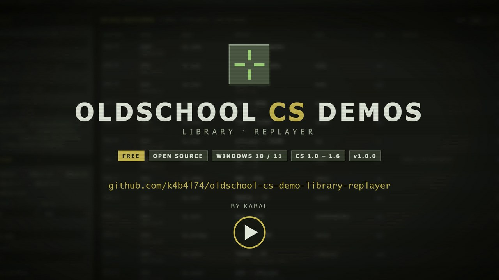
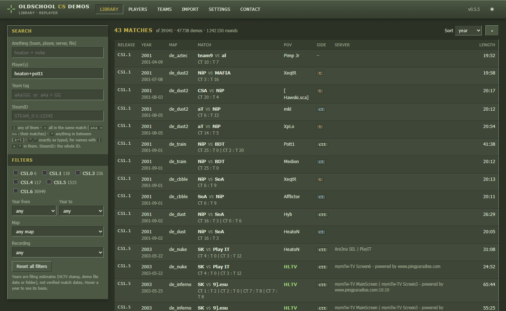
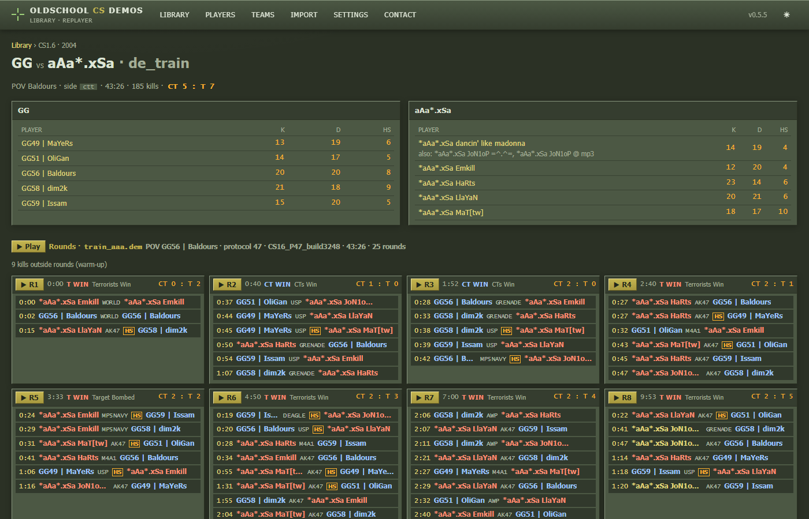
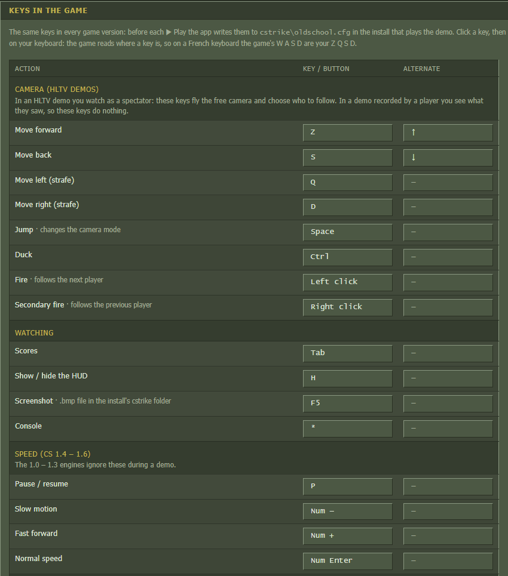

# Oldschool CS Demos Library Replayer

**Your library of Counter-Strike 1.0 – 1.6 demos.** 
Drop in old demos and archives, find any match, team or player, and watch it in the game version it was recorded with, from the start or from any round.

 
▶ <a href="docs/trailer/oldschool-cs-demos-trailer.mp4">Watch the trailer</a> (38 s, with sound)

## Why

Thousands of demos from the early years of Counter-Strike survive in old zip, rar and ace packs, with cryptic file names and no index. Playing one is a puzzle: a CS 1.3 demo only plays in the CS 1.3 engine, a 1.6 demo from 2003 needs a 2003 build, and the old engines have their own quirks.

This app does the work: it opens every archive, reads every demo, recognises teams, players, scores and rounds, groups halves into matches, and starts the right engine for you.

## Features

- **Import anything.** `.dem`, `.zip`, `.rar` (including old RAR 1.5/2.0), `.7z`, `.ace`, `.tar`, `.gz`… even archives inside archives. Drag files onto the window, drop them into a watched folder, or point the app at a whole collection on disk. Duplicates are recognised by content and skipped.
- **Know what you have.** Release (1.0 – 1.6), map, teams and line-ups, players with their SteamIDs and aliases, scores, every round with its kill feed, HLTV or player point of view, server, length, and an estimated year with its basis.
- **Find it fast.** Search 40,000 matches in well under a second, with a small search language in every text field (see below). Filters for release, year, map and recording type; player and team pages.
- **Watch it.** ▶ Play starts the matching engine. ▶ R5 jumps straight to round 5, and a click on a kill time starts a few seconds before that kill.
- **Your keys everywhere.** A Controls page like the game's: the same keys in every version (HLTV free camera, scores, HUD, screenshot, pause, slow motion, fast forward…), shown as printed on your own keyboard.
- **Never touches your files.** Originals are only read. Nothing leaves your PC: no account, no cloud, the app listens on `127.0.0.1` only.
- **An old-school look.** An olive theme inspired by the CS 1.x menus, and a light "paper" theme.

<table>
<tr>
<td width="58%"></td>
<td></td>
</tr>
<tr>
<td align="center">A match: line-ups, and every round with its kill feed. ▶ R7 starts at round 7.</td>
<td align="center">Keys in the game, as printed on your keyboard.</td>
</tr>
</table>

## Install

1. Download `OldschoolCSDemos-Setup-<version>.exe` from the [Releases](../../releases) page.
2. Run it. No administrator rights are needed. The app is not signed yet, so Windows SmartScreen may say "Windows protected your PC": click **More info**, then **Run anyway**.
3. The app opens in your browser and puts an icon next to the clock (right-click it to open the library, open the Drop folder or quit).

The setup is in English or French depending on Windows. Your library is kept in `%LOCALAPPDATA%\OldschoolCSDemos`; uninstalling asks whether to keep it (the default) or delete it.

## The game versions

Old demos only play in the engine that recorded them, so playback needs those versions installed, one folder per version, each with its `hl.exe`:

| Demos | Engine | Example folder name |
| --- | --- | --- |
| CS 1.0 / 1.1 (protocol 43) | WON 1.1.0.6 | `CS11_P43_hl1106` |
| CS 1.3 | WON 1.1.0.8 | `CS13_P45_hl1108` |
| CS 1.4 | WON 1.1.0.9 | `CS14_P45_hl1109` |
| CS 1.5 | WON 1.1.1.0 | `CS15_P46_hl1110` |
| CS 1.6, 2003 (protocol 46) | build 2511 | `CS16_P46_build2511` |
| CS 1.6 (protocol 47) | build 3248 | `CS16_P47_build3248` |
| CS 1.6 (protocol 48) | build 4554 | `CS16_P48_build4554` |

On the first start, give the app the folder that contains them: it finds each version, checks it, and picks the right one for every demo (you can override the choice in Settings). Keep `.` and `-` out of the WON install paths: those engines misread them.

**Where to get them:** a set of these installs (CS 1.1 to 1.6, all the versions above) is preserved on the Internet Archive: [Counter-Strike 1.1 to 1.6 old versions](https://archive.org/details/cs11to16-engines). Unzip `CS_ENGINES.zip` into a folder (for example `E:\Games\CS versions`) and give that folder to the app. Downloading them from inside the app is planned.

The app itself contains **no Valve files**. Everything except playback (import, search, match pages) works without any engine.

## Add demos

- **Drag** demo files or archives onto the app's window, on any page.
- **Copy** them into the Drop folder (`%LOCALAPPDATA%\OldschoolCSDemos\Drop`): they are imported a few seconds after the copy ends. Files that cannot be imported go to `_failed` with a note saying why; nothing is deleted.
- **Import a folder** where you keep a collection (Import page). Choose whether the demos are copied into the library (compressed) or read from that folder when played. Running it again later only reads the new files.

The Import page shows every import live, with a per-file report and links to the new matches.

## Where to find demos

Many old demo packs survive on the [Internet Archive](https://archive.org). Download them yourself, then add them to the app (they import as they are, archives included). Match counts below are what this app found in each collection: CS 1.0 – 1.6 matches only, after removing duplicates between collections.

**Big collections**

| Collection | What's inside | Download size |
| --- | --- | ---: |
| [HLTV Demo Archive](https://archive.org/details/hltv-demo-archive) | 19,500 CS 1.6 matches, 2005 – 2024, mostly HLTV | 87 GB |
| [Counter-Strike 1.6 Demos Collection](https://archive.org/details/counter-strike-1.6-demos-collection) | 8,550 matches from CS 1.0 to 1.6, 2001 – 2023, including about 1,000 from CS 1.0 – 1.5 | 191 GB (4 archives) |
| [pxl-lan Demo Archive](https://archive.org/details/pxl-lan-demo-archive) | 3,800 CS 1.6 matches, 2005 – 2012 (the rest is CS:Source / CS:GO) | 74 GB |
| [proplay.ru Download Archive](https://archive.org/details/proplay.ru-download-archive) | 2,300 CS 1.6 matches, 2005 – 2012 (the rest is mostly Warcraft III) | 27 GB |
| [CS 1.6 Demos](https://archive.org/details/cs-1.6-demos) | 1,100 CS 1.6 matches, 2005 – 2011 | 6.6 GB |
| [4players.de CS demo archive](https://archive.org/details/4players.de-cs-demo-archive) | 842 zips, 2004 – 2009, mostly CS:Source; a few CS 1.6 matches | 7.5 GB |

**Smaller packs**

| Pack | What's inside |
| --- | --- |
| [Counter-Strike Classic Demos](https://archive.org/details/counter-strike-classic-demos) | Curated tournament demos from CS 1.0 to 1.6 (ESWC 2004…), with a list of the matches still missing |
| [WCG 2007 Malaysia](https://archive.org/details/wcg-2007-malaysia-cs-1.6-demo-replays) · [WGT 2007 Malaysia](https://archive.org/details/wgt-2007-malaysia-cs-1.6-demo-replays) · [WGT 2008 Malaysia](https://archive.org/details/wgt-2008-malaysia-cs-1.6-demo-replays) | CS 1.6 tournament replays |
| [It is time to play CS 1.6 (f0rest)](https://archive.org/details/officialf0rest-it-is-time-to-play-cs1.6-HLTV-demos) · [Fastcup 5v5 Nostalgie Cup finals](https://archive.org/details/fastcups-5v5-nostalgie-cup-finals-HLTV-demos) | CS 1.6 HLTV demos from 2022 |
| [Counter-Strike 1.6 Online Demos](https://archive.org/details/Counter-Strike-1.6-Online-Demos) | 100 CS 1.6 public-server demos from 2024 |
| [KZ-Baltic](https://archive.org/details/kzbaltic) · [KZ – XJ / Cosy and other demos](https://archive.org/details/cs_kz_demos) · [kzmaps.co.uk archive](https://archive.org/details/kzmapscouk-demoarchive) | CS 1.6 jump and kreedz records (solo runs, not matches) |

Not usable by this app: [ClassicCounter Demos](https://archive.org/details/classiccounter-demos) (CS:GO) and the GFLClan archives (CS:Source). Know another pack? Open an [issue](../../issues).

## Search

Every text field of the Library search (Anything, Player(s), Team tag) understands:

| Type | Finds |
| --- | --- |
| `heaton\|pott1` | matches with either of them |
| `heaton + pott1` | matches where both played |
| `aAa + GG` (Team tag) | matches between these two teams |
| `k*l` | `*` is anything in between: kabal, kbl, kamel… |
| `"aAa\|KabaL"` | exactly as typed, for names that contain `\|`, `+` or `*` |

Matching ignores case and finds the text anywhere in a name. Years are filing estimates (HLTV stamp, file date or folder name), never verified match dates: hover a year to see its basis.

## FAQ

**Does it change my demo files?** No. Originals are only read. To play a demo, the app writes a temporary copy into the engine's folder (`csdemoplay.dem`), with the round jump and your keys added to that copy only.

**Which demos are supported?** GoldSrc Counter-Strike demos from 1.0 to 1.6, POV and HLTV. CS:Source and CS:GO demos are recognised and refused with a clear reason.

**A demo doesn't play.** The match page says why: usually no installed engine speaks that demo's network protocol, or a map is missing (the app copies missing maps from your other installs when it can).

**Can several people share a library?** Not yet: the app is a personal library on one PC.

**Is my data sent anywhere?** No. The app has no account, no telemetry, and serves its pages on `127.0.0.1` only.

## Build from source

Development happens on Windows with WSL 2; the backend is Python 3.12 (FastAPI, SQLite), the frontend React + TypeScript. See [CONTRIBUTING.md](CONTRIBUTING.md) to set up, run the tests and build the setup program, and [docs/ARCHITECTURE.md](docs/ARCHITECTURE.md) for how it works.

## Credits

- [7-Zip](https://www.7-zip.org/) (GNU LGPL, with the unRAR restriction) is shipped with the app to read old RAR archives.
- [acefile](https://pypi.org/project/acefile/) by Daniel Roethlisberger (BSD-2-Clause) reads ACE archives.
- Built with [FastAPI](https://fastapi.tiangolo.com/), [Uvicorn](https://www.uvicorn.org/), [React](https://react.dev/), [TanStack Query](https://tanstack.com/query), [Vite](https://vite.dev/), [PyInstaller](https://pyinstaller.org/) and [Inno Setup](https://jrsoftware.org/isinfo.php).

Counter-Strike and Half-Life are trademarks of Valve Corporation. This project is not affiliated with or endorsed by Valve.

## License

[MIT](LICENSE): use it, change it, share it, as long as the copyright notice stays. Bundled third-party parts keep their own licences (7-Zip: GNU LGPL with the unRAR restriction; acefile: BSD-2-Clause).

## Author

Made by **Guillaume &lt;KabaL&gt; ETTORI**: [GitHub](https://github.com/k4b4l74) · [X](https://x.com/the_kabal) · [YouTube](https://www.youtube.com/@k4b4l74).
Questions, ideas and bug reports are welcome in the [issues](../../issues).
